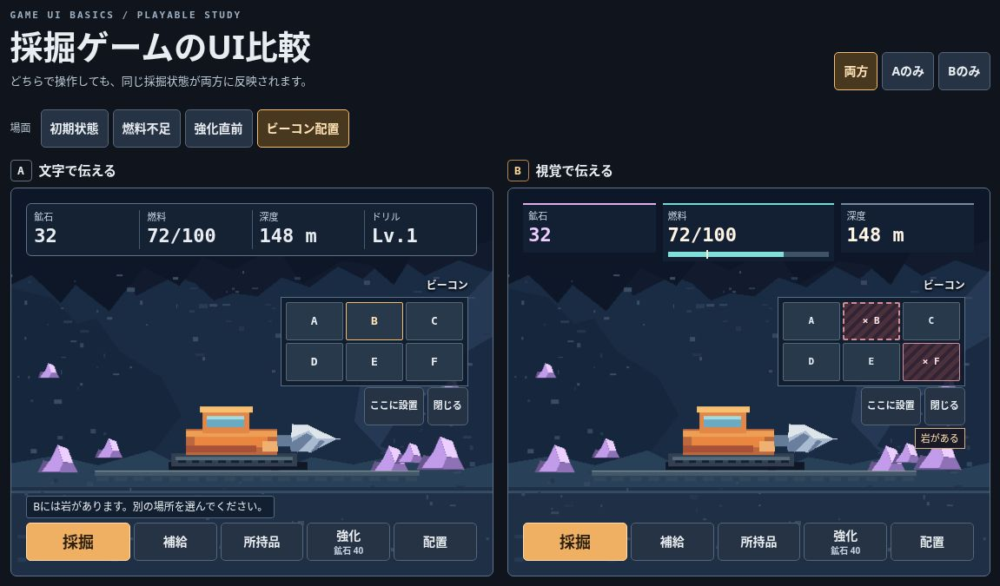

# Game UI Basics

ゲームUIの配置・視覚語彙・演出・UXをまとめたAI用スキル。**演出140種、比較GIF20本。**

[English](README.md) ｜ [スキルを使う](SKILL.md) ｜ [演出カタログ](references/motion-patterns.md)

## 見て、遊ぶ

**[スキルなし・ありを比べる](https://csoda.github.io/game_ui_basics/)** ｜ **[比較GIFを見る](https://csoda.github.io/game_ui_basics/samples.html)** ｜ **[ほしみなと管制局をPUNIPOで遊ぶ](https://punipo.com/g/789)**

比較デモはどちらを操作してもゲーム状態が揃います。ほしみなと管制局では[53種のUI演出](examples/port-techniques.md)を試せます。

## 作る、見直す

[配置](references/layout.md) ｜ [視覚語彙](references/visual-vocabulary.md) ｜ [ゲームUX](references/game-ux.md) ｜ [AIが作るときの注意点](references/ai-ui.md) ｜ [確認手順](references/review.md)
