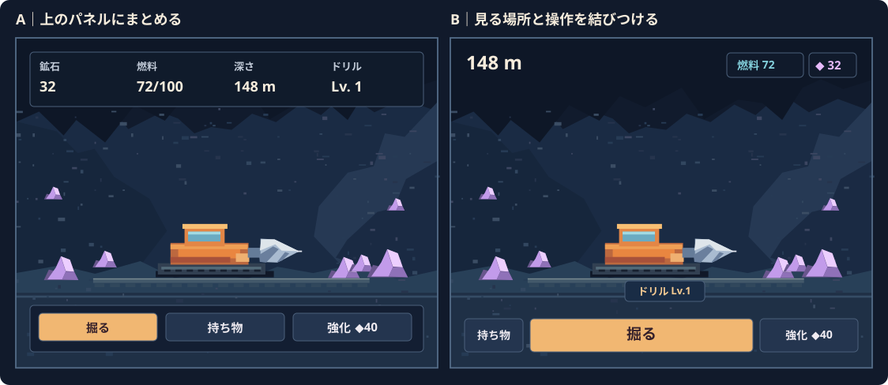

# Game UI Basics

ゲーム内UIを作るための、配置と動きの見本帳。HUD、メニュー、持ち物、操作への反応を扱います。コードを読まなくても見本を使えます。

## 同じゲーム、違うUI

同じ採掘画面で、見える情報と操作は同じ。Bではよく使う「掘る」を主役にして、燃料・鉱石、車体の状態、強化に必要な数を、それぞれ見る場面に寄せています。

**[ブラウザで試す](https://csoda.github.io/game_ui_basics/)** ｜ [HTMLファイル](examples/comparison.html)

「強化 → 掘る×2 → 強化」を両方で試せます。図は比較用の配置イメージで、実測の効果を示すものではありません。

## たとえば、減ったHPを見せる

- **[配置ガイド](references/layout.md)**：HUDやメニューの置き方12項目
- **[演出カタログ](references/motion-patterns.md)**：ゲームで使える動き100種。うち10種は比較GIF付き
- **[確認手順](references/review.md)**：連打や入力の違い、動きを減らした状態までチェック
- **[SKILL.md](SKILL.md)**：AIに使わせる場合の入口。必要な資料だけを開くようにしています

Codexなどから使うなら、リポジトリを参照できる状態にして「SKILL.md を使って、戦闘HUDの見直しをして」のように依頼してください。
