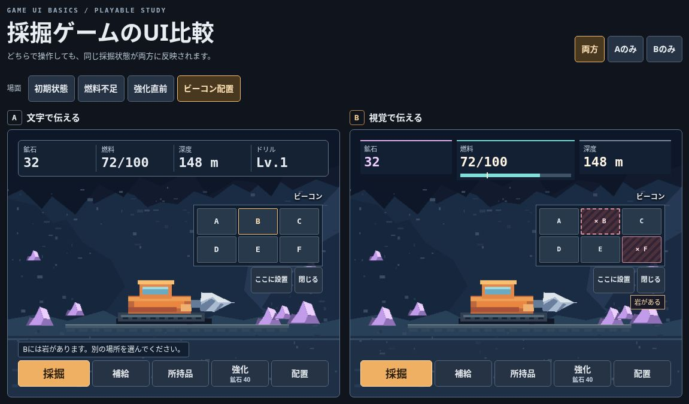

# Game UI Basics

ゲーム内UIの配置と動きの見本帳。HUD、メニュー、持ち物、操作への反応を扱います。

## スキルなし・ありを比べる

**[ブラウザで比べる](https://csoda.github.io/game_ui_basics/)** ｜ [単体HTML](examples/comparison.html)

Aは一般的な文字中心のUI、Bはスキルの考え方を使ったUI。どちらを操作しても燃料・鉱石・レベル・設置状態は揃います。「燃料不足」「強化の直前」「ビーコン配置」から試せます。スキルの有無を測るベンチマークではなく、同じゲームで見せ方を比べる作例です。

## GIFで見る

**[演出の比較GIF 20本](https://csoda.github.io/game_ui_basics/samples.html)**

HPの残像、長押し、装備を置ける枠、カードから詳細への切り替えなど。見たいGIFだけサンプルページで再生できます。

## UIが主役のゲーム：ほしみなと管制局

**[遊ぶ](https://csoda.github.io/game_ui_basics/port/)** ｜ [PUNIPO投稿用HTML](https://raw.githubusercontent.com/csoda/game_ui_basics/main/docs/port/index.html) ｜ [使った演出53種と試し方](examples/port-techniques.md)

入港待ちの船をドックへ振り分け、給油・積み込み・修理をさばきます。資材を節約するか、急ぎの船に使って出港を早めるか。UIの読み方と操作がそのまま攻略になります。

## ゲームで試す：ほしくず回収便

**[遊ぶ](https://csoda.github.io/game_ui_basics/punipo/)** ｜ [PUNIPO投稿用HTML](https://raw.githubusercontent.com/csoda/game_ui_basics/main/docs/punipo/index.html) ｜ [使った演出15種](examples/punipo-techniques.md)

ドラッグで鉱石を拾い、障害物をかわして50秒で帰還。HPの残像、連続拾得のまとめ表示、強化の3択、スコアの段階集計などが、プレイ中に出てきます。PUNIPO投稿用は外部素材なしのHTML1枚です。

## 作る・見直す

- **[視覚語彙ガイド](references/visual-vocabulary.md)**：形・位置・動きに何を任せるか。制作事例、初見と応用の確認手順つき
- **[配置ガイド](references/layout.md)**：HUDやメニューの置き方12項目
- **[演出カタログ](references/motion-patterns.md)**：ゲームで使える動き140種。うち20種は比較GIFあり
- **[AIがゲームUIを作るときの注意点](references/ai-ui.md)**：GPT語、説明文の減らし方、視覚語彙の使い方を修正例つきで紹介
- **[確認手順](references/review.md)**：連打や入力の違い、動きを減らした状態までチェック
- **[SKILL.md](SKILL.md)**：AIに使わせる場合の入口。必要な資料だけを開くようにしています

Codexなどから使うなら、リポジトリを参照できる状態にして「SKILL.md を使って、戦闘HUDを見直して」のように依頼してください。
