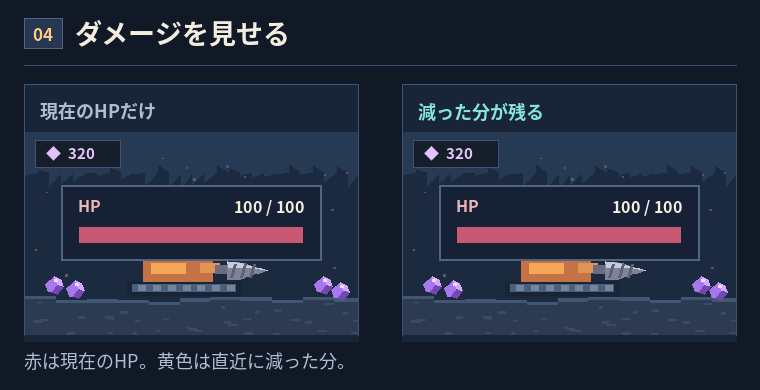

# Game UI Basics

An AI skill for game UI: layout, visual cues, motion, and player flow.
**140 UI techniques · 20 animated comparisons**

[日本語](README.ja.md) · [Use the skill](SKILL.md) · [Browse the catalog](references/motion-patterns.md)

## Try it

**[Play the A/B demo](https://csoda.github.io/game_ui_basics/)** · **[Watch the GIFs](https://csoda.github.io/game_ui_basics/samples.html)** · **[Play Star Harbor on PUNIPO](https://punipo.com/g/789)**

Same mining game, two UI approaches. Star Harbor puts [53 techniques](examples/port-techniques.md) into play.

